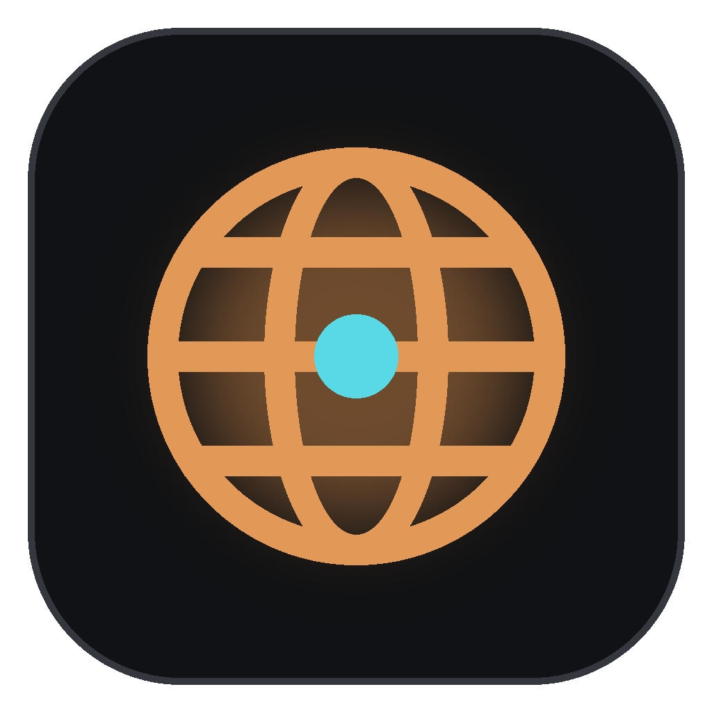
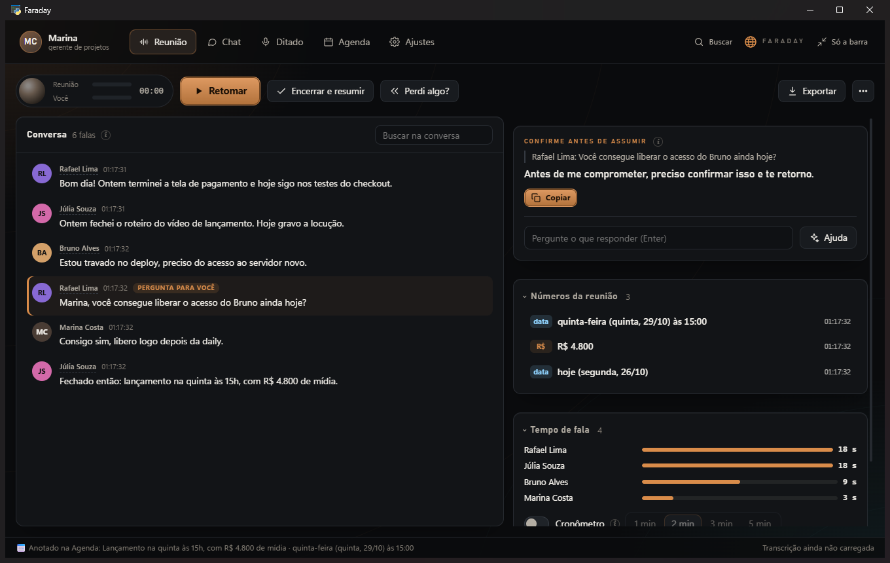
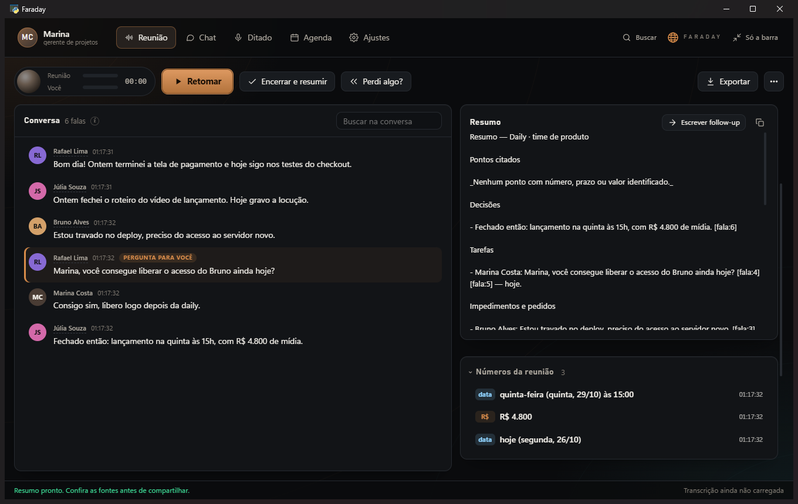
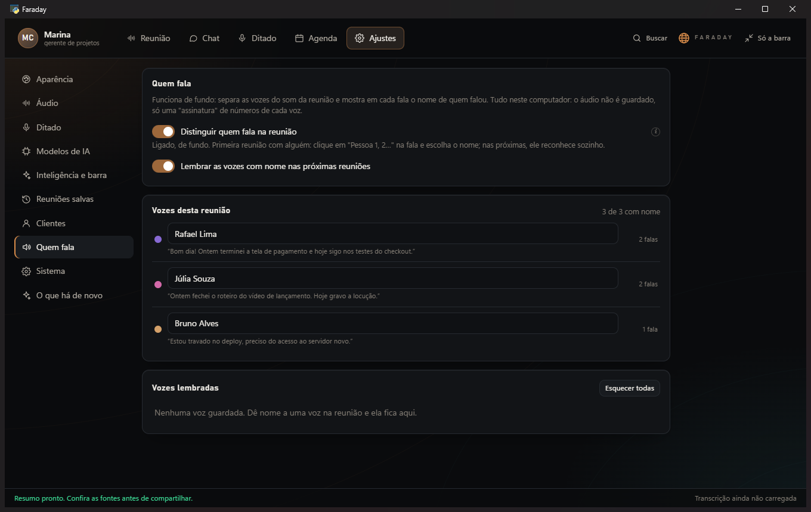

<h1 align="center">Faraday</h1>

<b>Seu assistente de reuniões e ditado, no seu computador.</b> 
Ouve a reunião, escreve tudo, mostra quem falou e sugere a resposta quando a pergunta é para você.

<a href="../../releases/latest"><b>⬇ Baixar o instalador para Windows</b></a>

---

## O que ele faz

- **Reunião ao vivo** — transcreve o que é dito na chamada (Teams, Meet, Zoom, Slack, Gather e outras) e o que você fala.
- **Quem falou** — reconhece as vozes e põe o nome de cada pessoa na fala. Da segunda reunião em diante, já sabe quem é quem.
- **Pergunta para você** — quando alguém te chama ("Marina, você consegue…?"), aparece uma sugestão de resposta tirada das suas notas.
- **Perdi algo?** — resume os últimos minutos quando você se distrai.
- **Resumo da reunião** — decisões, tarefas com o responsável, impedimentos e o resumo de cada pessoa na daily, pronto para colar no WhatsApp, Slack ou e-mail.
- **Ditado em qualquer programa** — segure o atalho, fale, solte: o texto entra onde o cursor estiver.
- **Chat** — pergunte sobre reuniões antigas: "o que o Rafael disse sobre o deploy?".
- **Agenda** — combinados com data falados na reunião entram sozinhos.

| | |
|---|---|
|  |  |

## Privado de verdade

Tudo acontece no seu computador: o áudio, as transcrições e os resumos das suas reuniões não saem dele. O programa só ouve, escreve e anota — nunca fala na reunião.

## Como instalar

1. Baixe **Instalar Faraday.exe** na [página de versões](../../releases/latest).
2. Abra e siga os passos.
3. Na primeira vez, digite a **chave de uso** que você recebeu (`FRDY-…`). Depois disso, o Faraday funciona mesmo sem internet.

As atualizações aparecem no próprio programa: um clique e ele se atualiza.

**Precisa de:** Windows 10 ou 11 (64 bits). Com placa de vídeo NVIDIA, fica ainda mais rápido.

## Chave de uso

O Faraday é distribuído com chave. Para conseguir uma, fale com quem te indicou o programa.

---

© 2026 Faraday. Todos os direitos reservados. Veja a [licença de uso](LICENSE.md).
